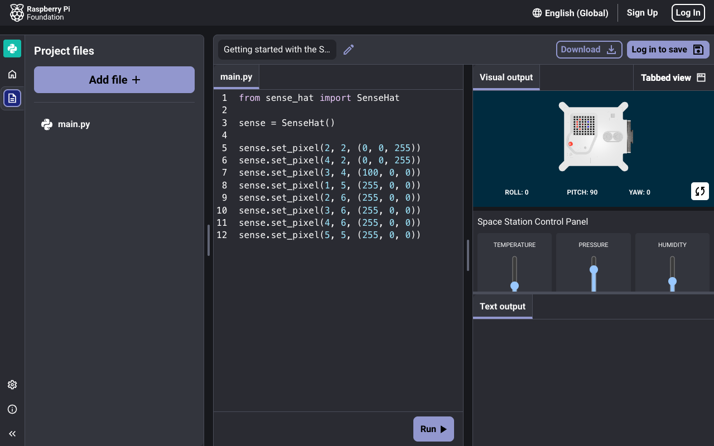
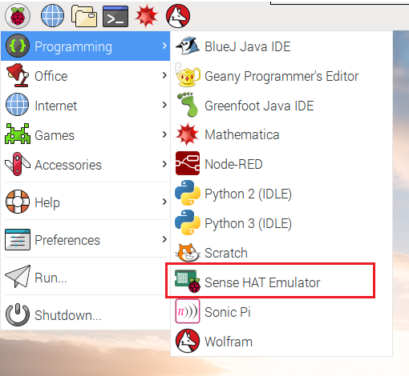

If you don’t have access to a Sense HAT, you can use the emulator.

### Online Sense HAT emulator

You can write and test code for the Sense HAT in your browser with the Code Editor, which has a Sense HAT emulator built in.



+ Open a [new Python project in the Code Editor](https://editor.raspberrypi.org/en/projects/blank-python-starter){:target="_blank"}. When your code imports `sense_hat` and you click **Run**, the Sense HAT emulator appears next to your code.

+ The emulator shows the Sense HAT on its side, so pictures are turned a quarter-turn clockwise. It doesn't have a joystick, so code that uses the joystick needs a real Sense HAT.

+ If you would like to save your work, log in to the Code Editor with a free Raspberry Pi Foundation account.

### Sense HAT emulator on the Raspberry Pi

If you are using a Raspberry Pi, there is a Sense HAT emulator included in the Raspbian operating system.



+ From the main menu, select **Programming** > **Sense HAT emulator** to open a window containing the emulator.

+ If you are using this version of the emulator, your program must import from `sense_emu` instead of `sense_hat`:

```python
from sense_emu import SenseHat
```

If you later want to run your code on a real Sense HAT, just change the import line as shown below. All other code can remain exactly the same.

```python
from sense_hat import SenseHat
```
